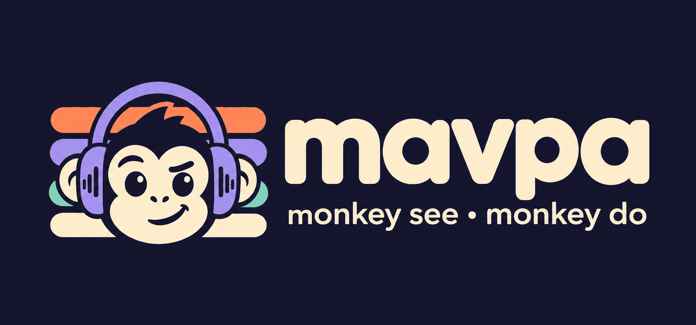
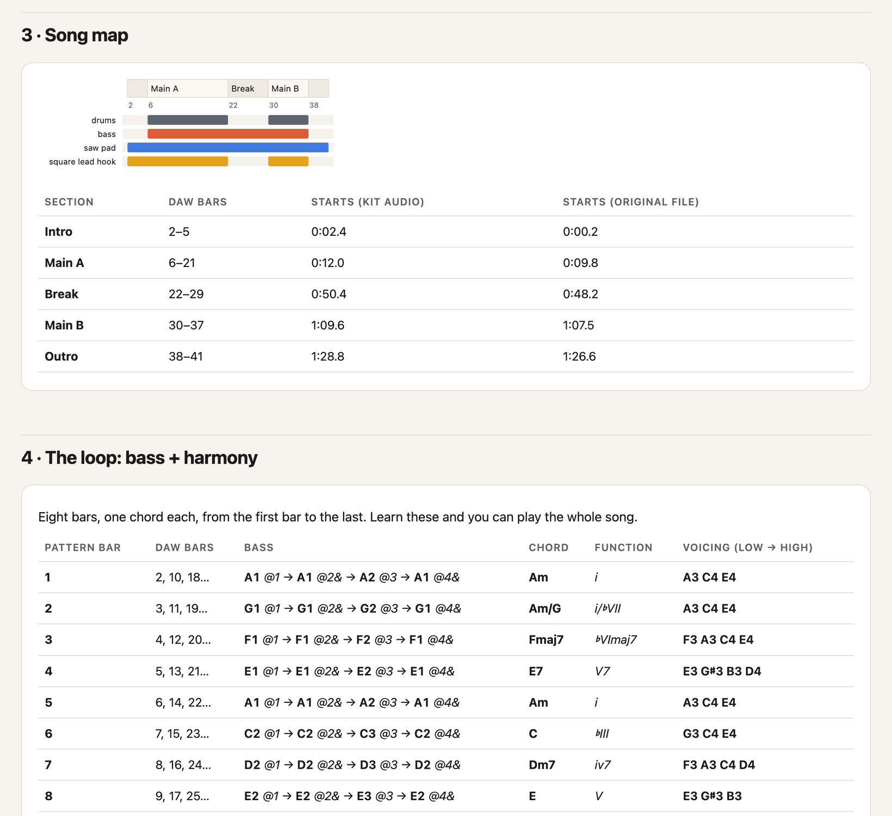
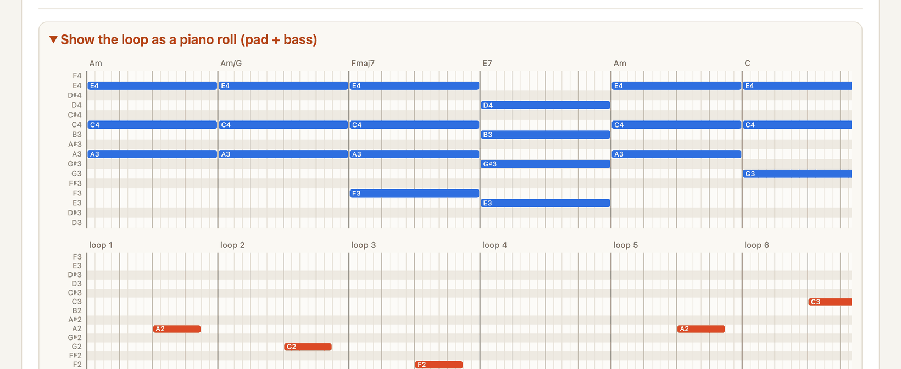
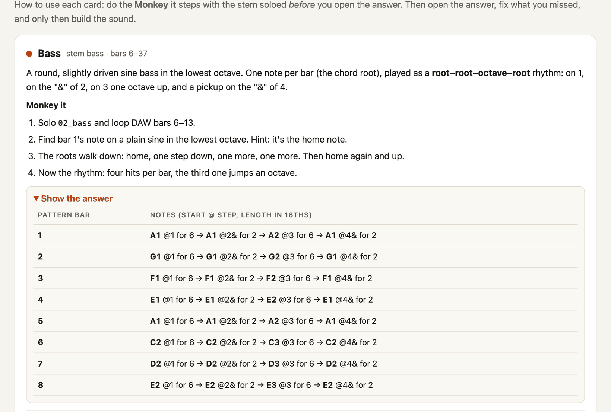
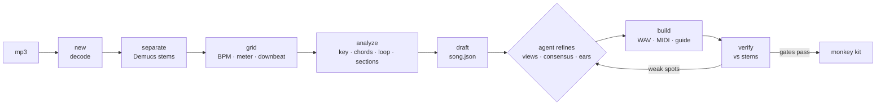

<p align="center">
  
</p>

<p align="center">
  <b>Split any track into its parts. Then rebuild it by hand.</b><br>
  <sub><i>mavpa</i> (Ukrainian <i>мавпа</i>, "monkey") is a learning tool and an agent harness for Claude Code and Codex.</sub>
</p>

<p align="center">
  <a href="#install"></a>
  <a href="#install"></a>
  
  
  <a href="LICENSE"></a>
</p>

---

## Why

Open any DAW for the first time and you freeze. There are hundreds of buttons, an empty
timeline, and a blank page staring back.

The way I learn best is to **monkey a master**: copy someone better, note by note, until your
hands know what your ears heard. That's how painters learned and how guitarists still learn.
For music production, the hard part is figuring out *what* exactly is happening in the
track. What's the tempo? Is it even 4/4? Which notes is the bass playing? Where does the
loop start?

**mavpa does that forensic part for you, and leaves the learning to you.** Give it an mp3
and you get a **monkey kit**: the song split into parts, with an answer key you can check
yourself against, and a lesson that teaches you to *hear* each part before you peek.

> mavpa started as one conversation: "decompose this track and teach me how to monkey it."
> The song turned out to be a 3/4 waltz at exactly 103 BPM in E Phrygian, which every beat
> tracker calls 4/4. Getting it right took stem separation, loop averaging, consensus
> transcription and a lot of checking. This repo is that process, saved as a harness so an
> agent can do it again for any song.

## What you get

```text
Your Song - monkey kit/
├── guide.html                  ← the lesson: open it first (offline, light/dark)
├── README.txt                  ← tempo, meter, key, how to line things up
├── audio/
│   ├── 00_full_mix_ALIGNED.wav ← the original, padded so bar 1 sits on the grid
│   ├── 01_drums.wav            ← AI-separated stems, same alignment
│   ├── 02_bass.wav
│   ├── 03_music.wav
│   └── 04_vocals.wav
└── midi/
    ├── 00_ALL_PARTS_full_song.mid   ← every layer in one file, with section markers
    ├── full_song/01_drums.mid …     ← one answer key per layer, drop it at bar 1
    └── loops/loop8_bass.mid …       ← the building blocks
```

Drag the folder into **Ableton Live** (Intro or Lite is enough), **FL Studio** or
**GarageBand** (free): set the tempo and time signature, drop everything at bar 1, and the
stems and MIDI line up.

<p align="center">
  
</p>

The guide covers:

1. **The song's DNA:** meter, tempo, scale on the keyboard, the loop, where bar 1 is.
2. **Session setup** for FL Studio, Ableton Live and GarageBand.
3. **A song map** that shows which layer plays where, with the drop-outs.
4. **The loop table:** chords, functions, the bass line and voicings for every bar.
5. **A card per layer** with *Monkey it* steps (ear-first hints, never the answer), a hidden
   answer (piano rolls, drum grids) and sound recipes for each DAW.
6. **A practice plan** and an honest *"how sure is this?"* section built from automatic checks.

<p align="center">
  
</p>

<p align="center">
  
</p>

## Install

### Claude Code

```text
/plugin marketplace add WorldInnovationsDepartment/mavpa
/plugin install mavpa@mavpa
```

(On Claude Code 2.1.275+ it's one step: `/plugin install mavpa --marketplace WorldInnovationsDepartment/mavpa`.)

### Codex

```bash
codex plugin marketplace add WorldInnovationsDepartment/mavpa
codex plugin add mavpa@mavpa
```

### Any agent that reads skills, or no agent at all

```bash
git clone https://github.com/WorldInnovationsDepartment/mavpa && cd mavpa
bin/mavpa doctor        # first run builds ~/.mavpa/venv (~1 GB: PyTorch, Demucs, librosa)
```

You need Python 3.10–3.12 and preferably [`uv`](https://docs.astral.sh/uv/) and `ffmpeg`.
Everything runs locally; the only downloads are the Python packages and the Demucs weights
(~300 MB, on first separation).

## Use it

In Claude Code:

```text
/mavpa:monkey ~/Downloads/song.mp3
```

Or just ask: *"monkey this track for me: ~/Downloads/song.mp3"*. The agent creates a
workspace, separates the stems, finds the grid, maps the song, drafts every layer, refines
them while looking at the spectrograms, checks itself against the stems, writes the lesson,
and tells you where the kit is.

By hand, the same pipeline is:

```bash
bin/mavpa new ~/Downloads/song.mp3              # → ~/mavpa/song/ (workspace)
bin/mavpa separate ~/mavpa/song                 # Demucs stems
bin/mavpa grid ~/mavpa/song --write             # tempo, meter, downbeat (+ evidence)
bin/mavpa analyze ~/mavpa/song                  # key, chords, loop, sections, drop-outs
bin/mavpa draft ~/mavpa/song                    # a complete first song.json
bin/mavpa build ~/mavpa/song                    # → ~/mavpa/song/kit/
bin/mavpa verify ~/mavpa/song                   # how good is it?
```

The automatic draft already builds a usable kit. The agent's job (or yours) is to turn it
into a great one: split hooks into their own layers, fix loop restarts, name the sections,
and write the lesson.

## How it works



1. **Grid:** a rigid-grid fit of BPM (to 0.001) and phase (to 0.5 ms), corrected from
   onset peaks to transient starts. Then the meter: harmonic change, bass change and kick
   onsets are folded by beat phase for 2, 3 and 4 beats per bar.
2. **Map:** bar-level self-similarity gives the loop length, phase matching finds where
   the loop *restarts*, and stem activity gives sections and one-bar drop-outs.
3. **Notes:** pYIN for bass, basic-pitch for the music stem, harmonic-sum salience for
   vocals, then **loop consensus**, which keeps only the notes that come back in most repeats.
   Drums are folded per frequency band over the loop.
4. **song.json:** layers made of patterns plus `play` entries (where each loop runs, which
   bars it skips). It mirrors how producers build songs: a few loops, copy-pasted and muted.
5. **Build** is deterministic: the same `song.json` gives the same kit, byte for byte.

### Why agent-first

A script can transcribe. Learning needs judgment. Is that note a chord tone or the 5th
harmonic of a pluck? Is this hook a separate layer? Does the loop restart after the break?
Which detail does a beginner need to hear first? mavpa gives an agent tools that **print
evidence and draw pictures** (agents can read spectrograms), a contract (`song.json`), quality
gates, and a written workflow (`skills/mavpa/SKILL.md`). The agent plays detective and
teacher; the toolbox keeps it honest.

## How good is it?

On the song mavpa was born from (4:14, 3/4 waltz, E Phrygian):

| | automatic draft | after the agent refines it |
|---|---|---|
| tempo / meter / downbeat | 103 BPM · 3/4 · 0.577 s ✓ | same |
| grid alignment (drum hits vs grid) | −0.5 ms median | −0.4 ms |
| bass notes match the bass stem | 96% | **99%** |
| chord/voicing similarity (random baseline) | 0.76 (0.39) | **0.80** (0.40) |
| drum hits confirmed in the stem | 97–99% | 95–99% |
| layers | 4 (one per stem) | 8 (808, pad, flick hook, A3 tick, top line, sparkle, vocal, drums) |

On the included demo song (generated, so the truth is known), the automatic draft finds
100 BPM, 4/4, A minor and the 8-bar loop with all eight chords right
(Am · Am/G · Fmaj7 · E7 · Am · C · Dm7 · E).

What it can't do:

1. Name the exact synth presets.
2. Read lyrics.
3. Follow songs with a drifting tempo (live bands without a click).

It tells you so in every kit.

## Try it on the demo song

```bash
~/.mavpa/venv/bin/python examples/make_demo.py /tmp/demo   # "Monkey Business": 96 s, original, + truth.json
bin/mavpa new /tmp/demo/demo.wav --name monkey-business
bin/mavpa separate ~/mavpa/monkey-business
cp examples/demo/song.json ~/mavpa/monkey-business/song.json    # a finished answer key
bin/mavpa build ~/mavpa/monkey-business && open ~/mavpa/monkey-business/kit/guide.html
```

`examples/demo/song.json` is what a finished, agent-refined answer key looks like: layers,
loops, arrangement, lesson text.

## Be nice

mavpa is for **personal study**. The kits contain stems and transcriptions of someone
else's music. Keep them on your machine, and don't publish them. Everything runs locally;
nothing is uploaded anywhere.

## Credits

1. [Demucs](https://github.com/facebookresearch/demucs) (Meta AI) for stem separation.
2. [basic-pitch](https://github.com/spotify/basic-pitch) (Spotify) for polyphonic notes.
3. [librosa](https://librosa.org) (pYIN, CQT, onsets), [pretty_midi](https://github.com/craffel/pretty-midi)
   and [mido](https://github.com/mido/mido) for audio and MIDI.
4. The logo was generated with Codex.
5. Built with Claude Code, one waltz at a time.

## License

[MIT](LICENSE) © Danylo Vorvul
